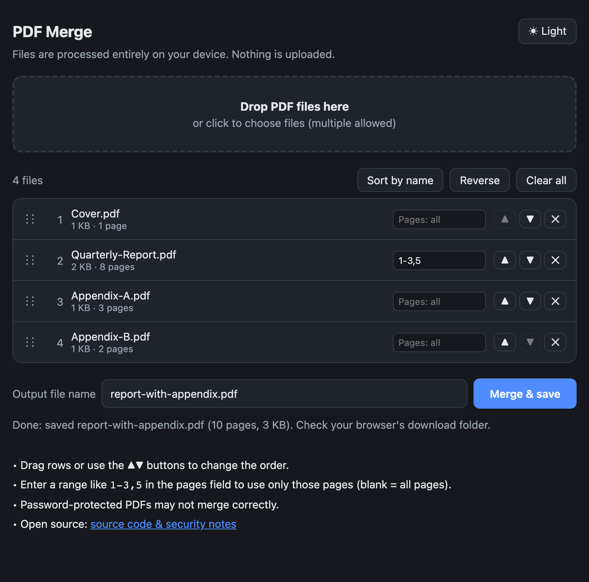

# pdf-merge

Merge PDFs in your browser — drag, drop, reorder. No install, no upload; everything runs locally.



## Usage

There are two ways to open the tool:

- **Online**: open <https://jojonki.github.io/pdf-merge/> in your browser.
- **Local**: download [`index.html`](index.html) (rename it if you like, e.g. `PDFMerge.html`) and open it in your browser. Works offline. To share the tool, just hand over this single file.

Then:

1. Drag and drop PDF files onto the page (or click to select them)
2. Reorder by dragging rows, using the ▲▼ buttons, or "Sort by name" / "Reverse"
3. Optionally specify which pages to use in the pages field (e.g. `1-3,5`; leave blank for all pages)
4. Enter an output file name and click "Merge & save"

Works in Chrome / Edge / Safari / Firefox on Windows and Mac.

## How it works

Merging is done entirely in the browser using [pdf-lib](https://pdf-lib.js.org/), which is inlined into `index.html`. Files are read with the File API, merged in memory, and saved via a `blob:` URL — no network requests are made.

Note: password-protected (encrypted) PDFs may not merge correctly.

## Security & Privacy

- **Nothing is uploaded.** Files are read, merged, and saved entirely in your browser. No server, analytics, cookies, or external resources.
- **Enforced by the browser.** A strict [Content Security Policy](https://developer.mozilla.org/en-US/docs/Web/HTTP/CSP) (`connect-src 'none'`, `default-src 'none'`) blocks all network requests from the page.
- **Verify it yourself.** Watch the DevTools Network tab while merging, or use the tool offline. All app code is in [`src/template.html`](src/template.html).
- **Third-party code.** Only [pdf-lib](https://github.com/Hopding/pdf-lib) 1.17.1 (MIT), inlined unmodified from npm. You can reproduce the build with `npm ci && npm run build && git diff --exit-code index.html`.
- **For sensitive documents**, prefer a downloaded local copy: the online version always serves the latest code from this repository.

Found a security issue? Please [open an issue](https://github.com/jojonki/pdf-merge/issues).

## Development

Edit `src/template.html`, then regenerate `index.html` (this inlines pdf-lib):

```sh
npm install
npm run build
```

## License

MIT
